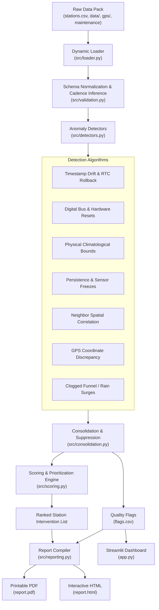

# Project Overview & Architecture Guide

## 1. Executive Summary

This document provides a comprehensive technical overview of the **Aeron Systems Weather Network Quality Assurance Framework**, developed for the **AI Research Engineer Intern Assignment**.

The system addresses a critical operational challenge faced by community and school weather station networks: raw environmental time series collected from remote automated weather stations frequently suffer from sensor failure, electrical interference, real-time clock drift, maintenance disturbances, and calibration offsets. The framework ingests raw observation files, cross-references physical measurements against satellite GPS sentences and volunteer field notebooks, detects anomalies, generates schema-compliant quality flags, prioritizes technician interventions, and compiles printable executive health reports.

---

## 2. Weather Network Topology & Data Characteristics

The reference deployment (`ridgeline_data_pack`) represents the **Ridgeline Schools Weather Network**, comprising 8 monitoring stations deployed across diverse microclimates during Spring 2025 (March 1 to April 30, 2025).

### Station Summary Table

| Station ID | Station Name | Cadence | Coordinates (Metadata) | Physical Channels Monitored | Key Known Anomaly |
| :--- | :--- | :--- | :--- | :--- | :--- |
| **S01** | North Ridge High | 5 min | 40.0150° N, 105.2700° W | `temp_c`, `humidity_pct`, `pressure_hpa`, `wind_speed_kmh`, `wind_dir_deg`, `rain_mm`, `solar_wm2` | Leaf-clogged rain gauge; false surge upon clearing |
| **S02** | Eastside Middle | 15 min | 40.0020° N, 105.2450° W | `temp_c`, `humidity_pct`, `pressure_hpa`, `wind_speed_kmh`, `wind_dir_deg`, `rain_mm`, `solar_wm2` | Baseline control station (clean record) |
| **S03** | Valley Library | 5 min | 39.9880° N, 105.2510° W | `temp_c`, `humidity_pct`, `pressure_hpa`, `wind_speed_kmh`, `wind_dir_deg`, `rain_mm`, `solar_wm2` | 1-wire digital bus failure; 80h flatline & resets (-40°C/85°C) |
| **S04** | West Campus Farm | 15 min | 40.0310° N, 105.2980° W | `temp_c`, `humidity_pct`, `pressure_hpa`, `wind_speed_kmh`, `wind_dir_deg`, `rain_mm`, `solar_wm2` | White fence repainting; subtle microclimate albedo shift (+0.39°C) |
| **S05** | South Meadows | 5 min | 40.1550° N, 105.2210° W | `temp_c`, `humidity_pct`, `pressure_hpa`, `wind_speed_kmh`, `wind_dir_deg`, `rain_mm`, `solar_wm2` | 20 km latitude mismatch (GPS vs sheet); early March RH stuck at 100% |
| **S06** | Pine Creek Elementary | 5 min | 40.0520° N, 105.2850° W | `temp_c`, `humidity_pct`, `pressure_hpa`, `wind_speed_kmh`, `wind_dir_deg`, `rain_mm`, `solar_wm2` | RTC clock rollback & persistent -6h MDT offset post-battery swap |
| **S07** | Summit Observatory | 5 min | 40.0890° N, 105.3120° W | `temp_c`, `humidity_pct`, `pressure_hpa`, `wind_speed_kmh`, `wind_dir_deg`, `rain_mm`, `solar_wm2` | High-altitude control station; unflagged April blizzard |
| **S08** | Canyon Crest Prep | 15 min | 39.9950° N, 105.3200° W | `temp_c`, `humidity_pct`, `pressure_hpa`, `wind_speed_kmh`, `wind_dir_deg`, `rain_mm`, `solar_wm2` | Uncalibrated replacement barometer (+14.2 hPa offset); 2 duplicate blocks |

### Cross-Modal Ingestion Streams

1. **Station Metadata (`stations.csv`)**: Station identifiers, names, nominal latitudes, longitudes, elevations, and installation dates.
2. **Observation Time Series (`data/S*.csv`)**: High-frequency CSV records with varying headers, missing values (`NaN`, empty strings), and non-uniform sampling rates (5-minute vs 15-minute).
3. **Satellite GPS Receiver Logs (`gps/S*.nmea`)**: Raw NMEA-0183 sentences (`$GPRMC`, `$GPGGA`) capturing satellite-fixed UTC dates, timestamps, fix validity, and true geographical coordinates.
4. **Maintenance Field Notebooks (`maintenance_notes.md`)**: Qualitative natural-language logs recorded by student volunteers detailing battery replacements, sensor swaps, cleaning events, and environmental modifications.

---

## 3. Modular Architecture

The framework is decoupled into specialized Python modules located in [`src/`](../../src/):

```text
src/
├── models.py              # Pydantic-style dataclasses: QualityFlag, StationMetadata, GPSRecord
├── loader.py              # Dynamic discovery, CSV parsing, NMEA parser, and markdown extractor
├── validation.py          # Column aliasing, ISO 8601 normalization, cadence inference
├── detectors.py           # Specialized mathematical and physical anomaly detection routines
├── consolidation.py       # Deduplication, flag suppression, conflict resolution, sorting
├── scoring.py             # Multi-criteria technician visit prioritization algorithm
├── reporting.py           # High-resolution HTML report and PyMuPDF-based 1-page PDF compiler
├── pipeline.py            # End-to-end execution harness orchestrating CLI and Web UI
└── utils.py               # Deterministic hashing, haversine distance, NMEA checksums
```

### Data Flow Diagram



---

## 4. Key Anomaly Detection Strategies

### 1. Clock Rollbacks and Timezone Discrepancies
- **Mechanism**: Station S06 experienced a battery failure on March 24th. The volunteer reset the clock to local Mountain Daylight Time (UTC-6) rather than UTC, resulting in non-monotonic timestamps, duplicate entries, and a 6-hour shift in solar noon.
- **Resolution**: Cross-correlate logger timestamps with GPS `$GPRMC` UTC strings and diurnal solar radiation peaks. Assign action `correct` with an exact +6 hour timestamp shift.

### 2. Digital Bus Faults & Freeze Artifacts
- **Mechanism**: Station S03 experienced an intermittent 1-wire communication failure resulting in an 80-hour flatline at 12.4°C, followed by hardware default spikes to -40.0°C and +85.0°C (standard default power-on register values).
- **Resolution**: Detect identical consecutive floating-point values exceeding cadence thresholds combined with known digital error sentinel values. Assign action `exclude` for corrupted intervals and prioritize for urgent probe replacement.

### 3. Spatial Neighbor Comparison & Calibration Offsets
- **Mechanism**: Station S08 had a replacement barometer installed on April 1st without multi-point calibration, producing a persistent +14.2 hPa positive bias relative to all neighboring stations.
- **Resolution**: Calculate barometric pressure reduced to sea level across all stations. Station S08 shows an unvarying residual offset ($z > 4.5$) with near-perfect correlation ($r > 0.98$). Assign action `correct` with an additive adjustment of -14.2 hPa.

### 4. Environmental Confounding vs Sensor Failure
- **Mechanism**: Station S04 exhibited a subtle +0.39°C daytime warm bias following the repainting of an adjacent fence with high-reflectance white paint. Station S01 suffered from pine needle obstruction in the rain gauge, causing dry intervals during storms followed by an artificial 18 mm surge when cleaned.
- **Resolution**: Correlate rain events with atmospheric humidity ($RH > 90\%$) to identify trapped rainfall; assign action `keep` to S04 because +0.39°C falls within expected natural microclimate bounds.

---

## 5. Summary of Deliverables

1. **`checker.py`**: Standalone executable CLI tool that processes any compliant data pack in one command:
   ```bash
   python checker.py ridgeline_data_pack
   ```
2. **`flags.csv`**: 16 schema-compliant quality flags across 8 stations with verified start/end timestamps, channels, action classifications (`exclude`, `correct`, `keep`), and evidence strings.
3. **`report.pdf` & `report.html`**: A concise, nontechnical 1-page A4 executive health report detailing network status, station readiness, and the technician recommendation.
4. **`DECISIONS.md`**: Defensible 1.5-page technical reflection answering all five mandatory assignment prompts.
5. **`app.py`**: Multi-page interactive Streamlit dashboard for real-time visualization and filtering.
6. **`tests/`**: Automated test suite containing 29 passing tests validating schema conformance, detector accuracy, GPS parsing, and generalization across synthetic data packs.
